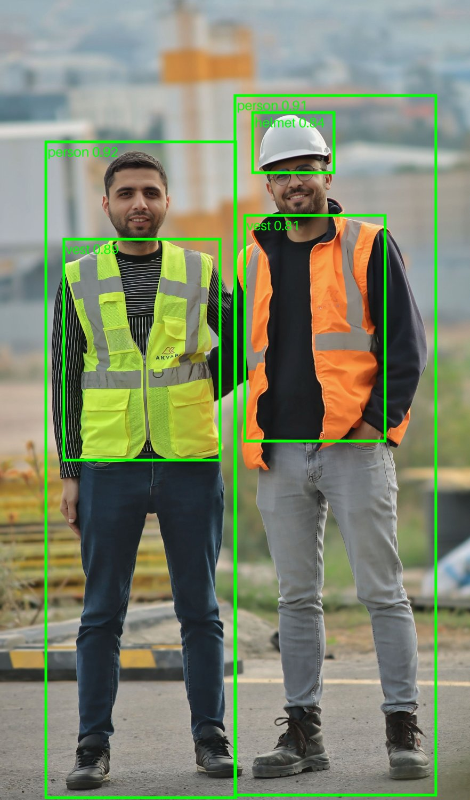

# Safety Gear Detector

YOLOv8 object detection for construction-site safety gear, trained on a free Colab T4 and served through FastAPI in Docker with an ONNX model (no PyTorch needed at serving time).

**Classes (6):** `boots`, `helmet`, `nohelmet`, `novest`, `person`, `vest`.
`nohelmet` and `novest` are the violation classes. The API returns `violation_found: true` when it detects either one.

## Results

Model: YOLOv8s fine-tuned from COCO weights (imgsz 640, batch 16, 60 epochs, seed 0, 0.624 h on a Colab T4).

| Evaluation set | Images | mAP@50 | mAP@50-95 | Precision | Recall |
|---|---|---|---|---|---|
| Validation (used to pick best.pt, most optimistic) | 392 | 0.914 | 0.628 | 0.906 | 0.887 |
| Full test | 131 | 0.926 | 0.656 | 0.913 | 0.881 |
| **Name-filtered test (headline, most conservative)** | 62 | **0.920** | **0.614** | 0.868 | 0.875 |

Per-class results on the name-filtered test set:

| Class | Precision | Recall | mAP@50 | mAP@50-95 | Boxes |
|---|---|---|---|---|---|
| boots | 0.767 | 0.933 | 0.957 | 0.721 | 15 |
| helmet | 0.948 | 0.969 | 0.993 | 0.718 | 76 |
| nohelmet | 0.805 | 0.765 | 0.832 | 0.419 | 27 |
| novest | 0.887 | 0.695 | 0.820 | 0.444 | 59 |
| person | 0.880 | 0.907 | 0.966 | 0.711 | 107 |
| vest | 0.917 | 0.980 | 0.949 | 0.674 | 50 |

Full tables for all three sets, software versions and notes: [results/metrics.md](results/metrics.md).
Confusion matrices and curves: [results/](results/) (validation) and [results/test/](results/test/) (full test).

### Data caveat
The dataset has overlap between splits. Many images are augmented copies of the same source photo, and 59 of the 119 unique test source names also appear in train (matched by file name, text before `.rf.`). So the validation and full-test scores are probably optimistic. The name-filtered test keeps only test images whose source name is not in train, so I use it as the headline. Matching is by file name only, so near-duplicates with different names may remain. The name-filtered numbers come from a one-off Colab cell that drops test images whose source name appears in train and then runs the same validation on the rest; that cell is not included as a script in this repo.

### Limitations
- The violation classes are the weakest: `nohelmet` (27 test boxes) and `novest` (59 test boxes) have the lowest mAP@50-95, and `novest` recall is 0.695. Missed violations are possible.
- The evaluation sets are small (62 to 131 images), so per-class numbers are noisy. `boots` has only 15 boxes in the filtered set.
- Model time per image reported by Ultralytics on a T4 was about 7 to 12 ms. This is not API latency. I have not measured the Docker API speed.
- One training image was skipped as corrupt (labels mix segment and detection rows), so 2,091 were used.

- `violation_found` is true only when the model itself predicts `nohelmet` or `novest`. A person with no helmet box at all is not flagged, because the app does not link helmets and vests to individual people.

## Demo



Output of `POST /predict/image` on a stock photo I downloaded for this demo. The model found both people (0.92, 0.91), both vests (0.89, 0.81) and the helmet on the right (0.84). **It missed the violation:** the man on the left wears no helmet, but the model produced no `nohelmet` box, so `violation_found` was `false`. This matches the weak `nohelmet` recall in the results above. It is a single image, not a measure of accuracy.

Photo by [Murat IŞIK](https://www.pexels.com/@bymuratisikofficial/) on [Pexels](https://www.pexels.com/photo/construction-workers-in-safety-gear-on-site-34670929/) (Pexels free license).

## Run the API (Docker)

```
docker build -t safety-gear-detector .
docker run --rm -p 8000:8000 safety-gear-detector
```

Then open http://localhost:8000/docs.

| Endpoint | What it does |
|---|---|
| `GET /health` | Server status, model name, class list |
| `POST /predict` | Upload an image, get detections as JSON (`class`, `confidence`, `box`, plus `violation_found`) |
| `POST /predict/image` | Upload an image, get it back with boxes drawn (red = violation, green = other) |

Example (Windows PowerShell):

```
curl.exe -X POST -F "file=@my_photo.jpg" http://localhost:8000/predict
```

Uploads over 10 MB are rejected with 413, and files that are not images with 400.

## Project files

| File | Purpose |
|---|---|
| `train.py` | Fine-tunes YOLOv8s (runs on Colab) |
| `evaluate.py` | Scores the model on a split and prints a results table (runs on Colab) |
| `export.py` | Converts `best.pt` to ONNX (runs on Colab) |
| `app.py` | FastAPI server: preprocessing, ONNX inference, NMS, JSON/image responses |
| `Dockerfile` | Builds the serving image (Python 3.14-slim, onnxruntime) |
| `requirements.txt` | Serving dependencies only |
| `models/best.onnx` | Exported model used by the API |

The PyTorch weights (`best.pt`) are not in the repo.

## Reproduce training (Colab)

1. Colab with a T4 GPU, `pip install ultralytics roboflow`, Roboflow API key in Colab Secrets.
2. Download PPE_master v1 in YOLOv8 format to `/content/ppe_data` and write `/content/ppe_data/data_fixed.yaml` with absolute paths (the downloaded `data.yaml` uses relative paths).
3. Run `train.py`, then `evaluate.py`, then `export.py`.

## Dataset and licenses

- Dataset: [PPE_master](https://universe.roboflow.com/harshajsn/ppe_master) v1 by harshaJSN on Roboflow Universe, licensed [CC BY 4.0](https://creativecommons.org/licenses/by/4.0/). I used the images and labels exactly as provided in version 1 and did not modify them. The name-filtered test set is a subset I selected for evaluation only. Some images look like stock photos with watermarks, so check the source before redistributing any dataset images.

- YOLOv8 comes from Ultralytics, which is licensed AGPL-3.0. Check the license terms before commercial use.